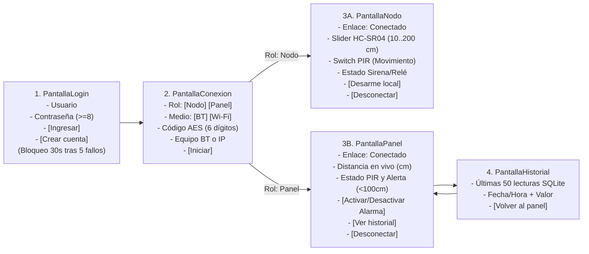

# MonitorIoT Perimetral — Unidad 2: Aplicación Móvil Android para IoT

- **Asignatura:** Aplicaciones Móviles para IoT (TI3042) · INACAP
- **Docente:** Juan Pablo Díaz
- **Estudiante:** Josué Quezada
- **Continuidad Unidad 1:** *Diseño e Implementación de un Sistema de Seguridad Perimetral Inalámbrico mediante ESP32* (Sensores PIR HC-SR501 + Ultrasónico HC-SR04 y Actuadores Relé Foco Disuasivo + Sirena Central)

---

## 1. Hito 1 — Definición del Proyecto (Criterio 2.1.1)

### 1.1 Problemática y conexión con la Unidad 1
La inseguridad en perímetros residenciales e industriales y la alta tasa de falsas alarmas en sistemas convencionales motivaron en la Unidad 1 el diseño de un sistema IoT de seguridad perimetral de doble factor (sensor infrarrojo PIR HC-SR501 y ultrasónico de distancia HC-SR04 con umbral `< 100 cm`) junto a una sirena y foco disuasivo por relé. En esta **Unidad 2**, se resuelve la necesidad de **monitorear y controlar dicho sistema de forma remota y segura desde dispositivos móviles Android**, utilizando dos teléfonos intercomunicados inalámbricamente: uno que simula el **Nodo IoT Perimetral** (sensores de distancia/PIR y actuador de relé/sirena) y otro que opera como **Panel de Control Central** con autenticación por roles, alertas en tiempo real e historial persistente.

### 1.2 Adaptación de la Unidad 1 a dos teléfonos Android

| Proyecto de la Unidad 1 | Qué simula el teléfono Nodo IoT | Qué hace el teléfono Panel de Control | Cuándo llega una notificación |
| :--- | :--- | :--- | :--- |
| **Sistema de Seguridad Perimetral** (PIR HC-SR501 + Ultrasónico HC-SR04 + Relé/Sirena) | Sensor de distancia ultrasónico (deslizador `10..200 cm`), detector de movimiento PIR (interruptor) y actuador de Sirena/Foco Relé (`ENCENDIDO` / `APAGADO`). | Visualiza en vivo la distancia en cm y el estado del PIR; activa o desactiva (arma/desarma) la Sirena/Foco Relé; consulta el historial en SQLite. | **Panel:** cuando la distancia baja de `100 cm` o el PIR detecta movimiento.<br>**Nodo:** al recibir cada comando (`ON`/`OFF`).<br>**Ambos:** si se pierde el enlace inalámbrico. |

### 1.3 Tabla de Funcionalidades

| ID | Funcionalidad | Quién la usa | Evaluación |
| :---: | :--- | :---: | :---: |
| **F1** | El nodo mide la distancia perimetral (cm) y el estado PIR, y los envía cada 2 segundos. | Nodo | Formativa · Sumativa |
| **F2** | El panel muestra la distancia en vivo, el estado del PIR y el estado del enlace. | Panel | Formativa · Sumativa |
| **F3** | El panel enciende o apaga la sirena/foco (relé) del nodo; el nodo confirma con `ACK`. | Panel → Nodo | Formativa · Sumativa |
| **F4** | Notificación local en el panel bajo el umbral de `100 cm` (o PIR activo) y en el nodo al recibir un comando. | Ambos | Formativa · Sumativa |
| **F5** | Si el enlace se corta: notificación en ambos y sirena/relé apagado automáticamente (**estado seguro OT**). | Ambos | Formativa · Sumativa |
| **F6** | Login con usuario y contraseña protegida (`PBKDF2`); roles `operador` y `observador`. | Panel | Sumativa |
| **F7** | Cada lectura perimetral se guarda en SQLite y se puede consultar en un historial con fecha y hora. | Panel | Sumativa |

### 1.4 Justificación de Herramientas
> «La aplicación se desarrolla de forma nativa en **Android Studio** con **Kotlin**, lenguaje oficial recomendado por Google para Android (*Kotlin-first*), que previene errores de referencias nulas y facilita el manejo asíncrono mediante **corrutinas** (`kotlinx.coroutines`) y flujos reactivos (`StateFlow` y `SharedFlow`) sin bloquear el hilo de interfaz. La interfaz de usuario se construye con **Jetpack Compose** y **Material Design 3**, siguiendo los estándares modernos de diseño Android. La comunicación inalámbrica emplea las APIs nativas de **Bluetooth clásico RFCOMM** (`android.bluetooth`) y de **sockets TCP sobre Wi-Fi** (`java.net`), sin depender de librerías externas. Los usuarios y el historial de lecturas perimetrales se almacenan localmente en **SQLite** (`SQLiteOpenHelper`), incluido en Android, permitiendo operar en terreno o plantas sin conexión a Internet. Las contraseñas se protegen con **PBKDF2-HmacSHA256** y los mensajes inalámbricos se cifran de extremo a extremo con **AES-256-GCM** mediante `javax.crypto`.»

---

## 2. Hito 2 — Diseño de la Solución (Criterios 2.1.1 y 2.1.2)

### 2.1 Elección y Justificación del Medio Inalámbrico

| Criterio | Análisis para el Sistema Perimetral | Decisión |
| :--- | :--- | :--- |
| **Distancia** | Pruebas en sala/laboratorio (`< 10 m`) y opción de perímetro interior extendido (`10–50 m`). | **Bluetooth Clásico (RFCOMM)** como medio principal y **Wi-Fi Local (TCP puerto 5050)** como alternativa seleccionable en pantalla. |
| **Consumo de energía** | Consumo medio en transmisión continua de tramas cortas cada 2 segundos. | Bluetooth Clásico consume menos energía que mantener sockets Wi-Fi de alta potencia. |
| **Estabilidad** | Las redes Wi-Fi institucionales suelen aplicar aislamiento de clientes (*AP Isolation*). | Bluetooth Clásico conecta directamente ambos teléfonos emparejados sin depender de routers externos; para Wi-Fi se soporta conexión directa al *hotspot* del teléfono. |

> **Justificación:** «Se elige **Bluetooth clásico (RFCOMM/SPP)** como medio principal porque el nodo y el panel operan de forma directa punto a punto sin depender de la red Wi-Fi de la sede (que suele aislar los equipos entre sí), ofrece un enlace autenticado por emparejamiento del sistema operativo y es directamente compatible con el perfil serial SPP del ESP32 para la Unidad 4. Adicionalmente, bajo la misma interfaz `Enlace`, se implementa **Wi-Fi local (sockets TCP en puerto 5050)** como alternativa para distancias mayores dentro del recinto conectando ambos equipos al *hotspot* del panel.»

### 2.2 Protocolo de Mensajes (`TIPO;CLAVE;VALOR`)
Los teléfonos intercambian una línea de texto cifrada con AES-256-GCM por mensaje, compuesta por tres partes separadas por punto y coma (`;`):

| Mensaje en texto claro | Dirección | Significado |
| :--- | :---: | :--- |
| `LECTURA;dist;85.0` | Nodo → Panel | Nueva lectura del sensor ultrasónico HC-SR04 en centímetros (formato con punto decimal `Locale.US`). |
| `LECTURA;pir;1` · `LECTURA;pir;0` | Nodo → Panel | Estado del sensor infrarrojo PIR (`1` = movimiento detectado, `0` = sin movimiento). |
| `CMD;alarma;ON` · `CMD;alarma;OFF` | Panel → Nodo | Orden del operador para activar o desactivar la sirena y foco disuasivo (relé). |
| `ACK;alarma;ON` · `ACK;alarma;OFF` | Nodo → Panel | Confirmación del nodo: el actuador (sirena/relé) cambió efectivamente a ese estado. |

*Cualquier línea que no cumpla exactamente con `3` campos, tipo en `{LECTURA, CMD, ACK}` o largo de clave/valor `<= 16` caracteres se descarta automáticamente en `Mensaje.desdeLinea()`.*

### 2.3 Mockup de Pantallas y Flujo de Navegación



### 2.4 Diseño del Login y Autenticación (Sumativa)
> «Se utiliza **SQLite local** (`monitoriot.db`) porque el sistema de seguridad perimetral debe operar de forma autónoma incluso sin acceso a Internet dentro de la instalación. **La contraseña nunca se almacena en texto claro**: al registrar un usuario se genera una sal criptográfica aleatoria de 16 bytes con `SecureRandom` y se calcula un resumen **PBKDF2WithHmacSHA256** de 256 bits con **120 000 iteraciones**. La verificación se realiza en tiempo constante mediante `MessageDigest.isEqual`. El **primer usuario registrado recibe el rol `operador`** (autorizado para activar/desactivar la sirena y foco relé) y los **siguientes reciben el rol `observador`** (solo monitoreo e historial, cumpliendo el principio de mínimo privilegio). Tras **5 intentos fallidos consecutivos**, el inicio de sesión se bloquea durante **30 segundos** para mitigar ataques de fuerza bruta.»

---

## 3. Estructura del Proyecto (`cl.inacap.monitoriot`)

```text
app/src/main/
├── AndroidManifest.xml                  ← Permisos mínimos (BT, Internet, Notificaciones) y endurecimiento
└── java/cl/inacap/monitoriot/
    ├── MainActivity.kt                  ← Punto de entrada, permisos en ejecución y navegación Compose
    ├── Sesion.kt                        ← Estado compartido (StateFlow), alertas y estado seguro OT
    ├── Notificaciones.kt                ← Canal de alta prioridad y notificaciones locales
    ├── datos/
    │   └── BaseDatos.kt                 ← SQLiteOpenHelper: tablas usuarios (sal+hash+rol) y lecturas
    ├── enlace/
    │   ├── Enlace.kt                    ← Protocolo Mensaje y clase base abstracta EnlaceBase
    │   ├── BluetoothEnlace.kt           ← Servidor y cliente Bluetooth clásico RFCOMM seguro
    │   └── WifiEnlace.kt                ← Servidor y cliente TCP por Wi-Fi local (puerto 5050)
    ├── seguridad/
    │   └── Cripto.kt                    ← PBKDF2-SHA256 (120k iteraciones) y cifrado AES-256-GCM
    └── ui/
        ├── PantallaLogin.kt             ← Login, registro de cuentas y bloqueo por fuerza bruta
        ├── PantallaConexion.kt          ← Selección de rol, medio, PIN de 6 dígitos y dispositivo/IP
        ├── PantallaNodo.kt              ← Simulador del Nodo Perimetral (HC-SR04, PIR y Relé/Sirena)
        ├── PantallaPanel.kt             ← Panel de Control Central con control de acceso por rol
        ├── PantallaHistorial.kt         ← Consulta de las últimas 50 lecturas en SQLite
        └── theme/                       ← Tema Material Design 3 (Color.kt, Theme.kt, Type.kt)
```

---

## 4. Hitos 4 y 7 — Seguridad ISO/IEC 27400 y Lineamientos OT (Criterio 2.1.3)

| Medida implementada | Qué hace | Dónde está en el código | Punto de la guía que cumple |
| :--- | :--- | :--- | :--- |
| **Hash PBKDF2-SHA256 con sal de 16 B y 120 000 iteraciones** | La contraseña nunca se guarda; calcular el hash toma tiempo deliberadamente para frenar el *cracking* offline. | `Cripto.hash`, `BaseDatos.registrar` | Cifrado de credenciales |
| **Comparación en tiempo constante** | `MessageDigest.isEqual` evita ataques de temporización (*timing attacks*) al comparar hashes. | `Cripto.verificar` | Cifrado de credenciales |
| **Bloqueo tras 5 intentos fallidos (30 s)** | Frena los ataques de fuerza bruta interactivos en la pantalla de login. | `PantallaLogin.kt` | Control de acceso |
| **Control de acceso basado en roles (`operador` / `observador`)** | Aplica el principio de **mínimo privilegio** (IEC 62443): solo el `operador` puede enviar comandos al actuador. | `BaseDatos.registrar`, `PantallaPanel.kt` | Control de acceso |
| **Cifrado autenticado AES-256-GCM en cada mensaje** | Cada línea viaja con un IV aleatorio de 12 bytes y etiqueta de autenticación GCM de 128 bits derivada del código de 6 dígitos. Si alguien altera o inyecta datos, se descartan. | `Cripto.cifrar`, `Cripto.descifrar`, `EnlaceBase` | Cifrado de datos sensibles en tránsito |
| **Bluetooth emparejado (RFCOMM seguro)** | `listenUsingRfcommWithServiceRecord` (sin `Insecure`) exige emparejamiento previo y cifra el enlace a nivel de controlador Bluetooth. | `BluetoothEnlace.kt` | Conexiones seguras |
| **`usesCleartextTraffic="false"`** | Android bloquea cualquier tráfico HTTP en texto plano no cifrado a nivel de sistema. | `AndroidManifest.xml` | HTTPS / TLS |
| **Consultas SQL parametrizadas (`?`)** | Separa el código SQL de los datos del usuario, impidiendo ataques de **inyección SQL**. | `BaseDatos.kt` | Protección de datos |
| **Validación estricta del protocolo de mensajes** | `Mensaje.desdeLinea` descarta cualquier trama que no sea `LECTURA`, `CMD` o `ACK` con largo acotado (`<= 16`). | `Enlace.kt` | Protección de datos |
| **`allowBackup="false"`** | Impide extraer la base de datos SQLite del teléfono mediante respaldos ADB o de nube. | `AndroidManifest.xml` | Protección de datos en reposo |
| **Permisos mínimos y en tiempo de ejecución** | Solo se solicita `BLUETOOTH_CONNECT` (Android 12+) y `POST_NOTIFICATIONS` (Android 13+), sin pedir ubicación ni escaneo. | `AndroidManifest.xml`, `MainActivity.kt` | Permisos adecuados |
| **Estado seguro ante pérdida de enlace (*Fail-Safe*)** | Si se corta la conexión Bluetooth o Wi-Fi, el nodo apaga inmediatamente el relé/sirena (`alarmaActiva = false`) y notifica a ambos equipos. | `Sesion.kt` | Lineamiento de industria OT (IEC 62443) |

> **Declaración de límites de seguridad para entorno productivo:** Un código de vinculación de 6 dígitos y una sal fija para derivar la clave de sesión son apropiados para la demostración académica, pero en producción industrial se reemplazarían por un intercambio de claves efímeras (**ECDH**) autenticado con certificados almacenados en el **Android Keystore** (y en el módulo de hardware **mbedTLS / Secure Element** del ESP32). Asimismo, el nodo validaría criptográficamente el token de rol del emisor antes de ejecutar un comando `CMD`.

---

## 5. Hitos 4 y 7 — Tabla de Pruebas de Funcionamiento (P1 a P14)

| ID | Caso de prueba | Pasos ejecutados | Resultado esperado y verificado |
| :---: | :--- | :--- | :--- |
| **P1** | **Conexión** | Teléfono A inicia como **Nodo** (espera); Teléfono B elige **Panel**, selecciona a A e inicia con el mismo código `123456`. | Ambos teléfonos muestran `Enlace: Conectado`. |
| **P2** | **Monitoreo en vivo** | Mover el deslizador de distancia del Nodo a `120.0 cm` y alternar el switch PIR. | El Panel actualiza la distancia a `120.0 cm` y el estado del PIR en 2 segundos o menos. |
| **P3** | **Alerta por umbral** | Bajar el deslizador del Nodo a `65.0 cm` (bajo el umbral de `100.0 cm`). | Llega una notificación de alta prioridad al Panel («Intruso detectado a 65.0 cm»); no se repite hasta subir sobre `100 cm` y volver a bajar. |
| **P4** | **Control de actuador** | En el Panel presionar «Activar Sirena / Foco Disuasivo». | El Nodo cambia a `Sirena / Foco Relé: ENCENDIDO`, recibe una notificación local y envía `ACK;alarma;ON` reflejándose en el Panel. |
| **P5** | **Código AES distinto** | Conectar Nodo con código `111111` y Panel con `222222`. | El socket se conecta, pero `Cripto.descifrar` devuelve `null` por fallo de etiqueta GCM: **no pasa ningún dato ni comando**. |
| **P6** | **Pérdida de enlace (Estado seguro OT)** | Apagar el Bluetooth del Nodo mientras la Sirena/Relé está `ENCENDIDO`. | Ambos equipos muestran la notificación «Enlace perdido» y la Sirena/Relé del Nodo pasa automáticamente a `APAGADO`. |
| **P7** | **Permiso negado** | Negar el permiso de dispositivos cercanos (Bluetooth) e intentar iniciar en la pantalla de conexión. | Se muestra el mensaje en pantalla «Falta el permiso de Bluetooth…» sin que la aplicación se cierre. |
| **P8** | **Registro y roles** | Crear una primera cuenta (`admin`) y luego cerrar sesión y crear una segunda cuenta (`guardia`). | `admin` queda registrado con rol `operador`; `guardia` queda asignado automáticamente como `observador`. |
| **P9** | **Login incorrecto y bloqueo** | Ingresar una contraseña errónea 5 veces seguidas. | Se informa cada intento fallido y al 5.º intento se bloquean los botones durante 30 segundos. |
| **P10** | **Contraseña corta** | Intentar registrar o ingresar con una contraseña de 5 caracteres. | Se rechaza inmediatamente con el aviso «Escribe un usuario y una contraseña de al menos 8 caracteres». |
| **P11** | **Control de acceso por rol** | Ingresar con la segunda cuenta (`observador`) y conectar el Panel al Nodo. | El observador visualiza la distancia y alertas en tiempo real, pero el botón de activar/desactivar sirena está **deshabilitado**. |
| **P12** | **Almacenamiento SQLite** | Mantener la conexión activa durante 1 minuto y abrir «Ver historial de lecturas». | Se listan las ~30 lecturas recibidas ordenadas desde la más reciente con su fecha, hora y valor en cm. |
| **P13** | **Persistencia** | Cerrar completamente la app y volver a abrirla e ir al historial. | Las lecturas y los usuarios registrados permanecen almacenados en `monitoriot.db`. |
| **P14** | **Credenciales protegidas** | Inspeccionar la tabla `usuarios` en *Database Inspector* (`monitoriot.db`). | Solo existen las columnas `usuario`, `sal` (`BLOB`), `hash` (`BLOB`) y `rol`; la contraseña en claro no existe en ningún lugar. |

---

## 6. Hito 8 — Cómo Ejecutar el Proyecto 

### 6.1 Cómo abrir y compilar el proyecto
1. Abrir **Android Studio** → **Open** y seleccionar la carpeta `MonitorIoT`.
2. Esperar a que termine la sincronización automática de Gradle (*Sync Project with Gradle Files*).
3. En ambos teléfonos Android físicos, activar **Opciones de desarrollador** y **Depuración por USB** (o generar el APK desde **Build → Generate App Bundles or APKs → Generate APKs**, ubicado en `app/build/outputs/apk/debug/app-debug.apk`).
4. Emparejar ambos teléfonos una vez en **Ajustes → Bluetooth → Vincular nuevo dispositivo** (si se usa Bluetooth) o conectar ambos a la misma red / *hotspot* (si se usa Wi-Fi).


